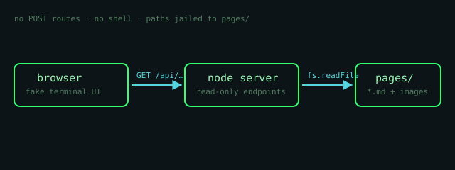

# Markdown Demo

This page exercises the renderer. Everything below is ordinary Markdown from
a file in `pages/`.

## Text styles

**bold**, *italic*, ***both***, ~~struck~~, `inline code`, and a
[link back to welcome](welcome.md).

## Lists

1. ordered
2. items
   - nested
   - bullets

## Quote

> “The best way to predict the future is to invent it.”
> — Alan Kay

## Code block

```js
function greet(visitor) {
  console.log(`hello, ${visitor}`);
}
greet('guest');
```

## Table

| feature | supported |
| ------- | :-------: |
| headings | ✅ |
| images | ✅ |
| code blocks | ✅ |
| tables | ✅ |

## Images

Images live next to the posts (e.g. `pages/assets/`) and are referenced with
a relative path. The server serves them through a whitelisted, read-only
`/files/` route:



You can also embed external images with a full URL — they load straight from
the internet.

---

*That's it — delete this file and it's gone from `ls`.*
